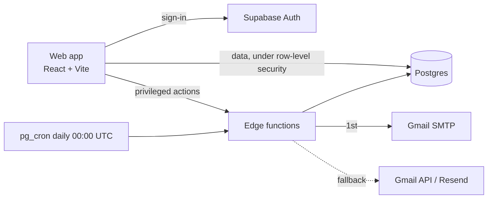

# Leadership Compass by Formidea

**See yourself the way others see you, and chart your growth.**

Leadership Compass runs leadership **self and 360-degree assessments**. Administrators set up review cycles, people are
invited by email, and every employee rates 19 leadership competencies for themselves and for the people around them in
the org structure. Each person gets a report with readiness, strengths, blind spots and a development plan. Feedback from peers and direct reports stays anonymous.

- **Live app:** https://leadership-compass-formidea.netlify.app
- **Product requirements:** *Leadership Compass — Product Requirements* (shared document)
- **Email setup:** [SETUP-EMAIL.md](SETUP-EMAIL.md)
- **Rebuilding in Bolt:** [BOLT-BUILD-SCRIPT.md](BOLT-BUILD-SCRIPT.md) and [BOLT-PROMPT.md](BOLT-PROMPT.md)

---

## Contents

1. [Features](#features)
2. [Roles and access](#roles-and-access)
3. [How it is built](#how-it-is-built)
4. [Project structure](#project-structure)
5. [Run it locally](#run-it-locally)
6. [Set up Supabase](#set-up-supabase)
7. [Publish the web app](#publish-the-web-app)
8. [Using the app](#using-the-app)
9. [Bulk upload reference](#bulk-upload-reference)
10. [Security](#security)
11. [Reference: edge functions and scripts](#reference-edge-functions-and-scripts)
12. [Development](#development)
13. [Troubleshooting](#troubleshooting)

---

## Features

| Area | What it does |
| --- | --- |
| **Assessments** | 19 competencies in 4 categories (Leading Self, Leading Others, Leading the Business, Leading Change). Each assessor gives a 1–5 rating and a behaviour note per competency; drafts save automatically; forms lock on submit and at the cycle's close date. |
| **Org structure** | Org chart of reporting lines (immediate manager; skip-level is automatic). Peers per person with no minimum or maximum: employees suggest, the immediate manager approves; admins and managers assign directly. Per-person exclusions: not rated by others, does not rate others, no self-assessment. |
| **Without an account** | People with no active account answer by a **secure email link** (one per person per cycle, works until the cycle closes, resend or switch off per cycle). **Quick add** puts an employee in the org chart without an invitation; **external raters** (clients, partners, contractors) are added per employee, never get an account, and form an anonymous *External* group in reports. |
| **Review cycles** | Draft → open → closed, with reminders, submit alerts and a minimum group size for anonymity. Each cycle chooses which relationships to include (self, manager, skip-level manager, direct reports, skip-level reports, peers). Opening builds every evaluation from the org structure as a snapshot; admins can refresh it and send invitations immediately. Administrators can **Restart** a cycle (clears every answer, back to draft) or **Delete** it, confirmed by typing its name. |
| **Reports** | Admin-only by default, with *Individual feedback* (named for managers, anonymous for others) and sharing of the consolidated or individual report with the immediate or skip-level manager. Employees see their own report automatically after the cycle closes. Scores by rater group, band (Strength / Developing / Development need), perception (Blind spot / Hidden strength / Aligned), readiness by category, three focus areas with actions, and a 30–360 day plan. |
| **User control** | Add users (they choose their own password through an emailed 6-digit code), change roles, give **view or edit access per module**, deactivate and reactivate, require a new password, resend invites. |
| **Groups** | Named groups (team, batch, cohort); filter and badge people by group. |
| **Bulk upload** | Onboard up to 500 people from an Excel template, with department, position, immediate manager, direct reports, peers and groups. Every row is checked before anything is created. |
| **Audit trail** | Append-only record of app actions, data changes (before/after) and sign-ins; search, filter and CSV export. |
| **Notifications** | Invites, codes, reminders, confirmations, alerts and "dashboard ready" emails through Gmail; per-person preferences; admin-only settings. |
| **Brand** | Formidea theme: Public Sans, deep blue `#005B99`, red call to action `#D83024`, light and dark mode, works on phones. |

## Roles and access

Everyone uses **one sign-in page**. What a person sees comes from their role and any module access an admin gives them.

| Role | Can do |
| --- | --- |
| **Administrator** | Everything, including user control, module access, the audit trail and Notifications / Settings. |
| **Employee** | Everyone else. Completes a self-assessment and the evaluations generated from the org structure; suggests peers; sees their own report after the cycle closes. |

There is no separate manager role: anyone who has direct reports in the org structure also gets **My team** (approve
peer suggestions, assign peers, see reports an administrator shared with them).

**Module access** (set per person in *Users > Access*): Dashboard and Audit trail (view), Cycles, People, Org structure,
Assignments and Users (view or edit). **Notifications / Settings is admin-only** and can never be granted. Access is
enforced in the database and the server functions, not only by hiding buttons.

Guardrails: nobody changes their own role, access or status; the last active administrator cannot be removed; only
administrators create administrators or change module access.

## How it is built

| Layer | Technology |
| --- | --- |
| Web app | React 18, TypeScript, Vite, Tailwind CSS, lucide-react icons |
| Data and sign-in | Supabase: Postgres with row-level security on every table, Supabase Auth |
| Server logic | 22 Supabase Edge Functions (Deno) |
| Email | Gmail SMTP with an App password (Gmail API with OAuth, and Resend, as fallbacks) |
| Scheduling | `pg_cron` + `pg_net` call the `daily-scheduler` function every day at 00:00 UTC |
| Excel | `read-excel-file` and `write-excel-file` (pinned versions, loaded only in the Bulk upload dialog) |
| Hosting | Netlify (static site with security headers from [netlify.toml](netlify.toml)) |



## Project structure

```
.
├── src/
│   ├── auth/                 Sign-in state, profile and module access
│   ├── components/           App shell, brand mark, modal, notices, badges
│   ├── features/
│   │   ├── assessments/      My assessments and the feedback form
│   │   ├── assignments/      Assessors per cycle and talent
│   │   ├── audit/            Audit trail screen
│   │   ├── auth/             Sign-in, activation and forgot password
│   │   ├── cycles/           Review cycles and coverage warnings
│   │   ├── landing/          Public landing page sections
│   │   ├── notifications/    Notification and sender settings (admin)
│   │   ├── people/           Everyone with an account
│   │   ├── reports/          Dashboard and talent report
│   │   ├── talents/          Talents and their managers
│   │   ├── tour/             Welcome tour
│   │   └── users/            User control, groups and Excel bulk upload
│   ├── lib/                  Supabase client, types, module access helpers
│   └── pages/                Login, activate, workspace, privacy
├── supabase/
│   ├── migrations/           30 SQL migrations (schema, access rules, audit, reports)
│   └── functions/            22 edge functions + _shared helpers
├── scripts/                  Setup and sharing scripts (see Reference)
├── public/                   Favicon and SPA redirects
├── netlify.toml              Hosting build settings and security headers
├── SETUP-EMAIL.md            Gmail setup guide
├── BOLT-PROMPT.md            First message after importing into Bolt
└── BOLT-BUILD-SCRIPT.md      12 prompts that rebuild the app in Bolt
```

## Run it locally

**Needs:** Node.js 20 or later (22 recommended) and a Supabase project that is already set up (next section).

```bash
npm ci
```

Create a `.env` file in the project folder (it is git-ignored) with your project's public values from
*Supabase > Project Settings > API*:

```
VITE_SUPABASE_URL=https://<project-ref>.supabase.co
VITE_SUPABASE_ANON_KEY=<anon public key>
```

```bash
npm run dev
```

Open http://localhost:5173. The anon key is public by design; never put the service role key in `.env`.

## Set up Supabase

Do this once for a new Supabase project. Commands run from the project folder.

**1. Sign in to the CLI and link the project**

```bash
npx supabase login
```

```bash
npx supabase link --project-ref <project-ref>
```

**2. Create the database and deploy the functions**

```bash
npx supabase db push
```

```bash
npx supabase functions deploy
```

**3. Set the secrets** (*Edge Functions > Secrets*, or `npx supabase secrets set NAME=value`)

| Secret | What it is for |
| --- | --- |
| `GMAIL_SMTP_USER` | Gmail or Google Workspace address that sends every email |
| `GMAIL_SMTP_APP_PASSWORD` | Google App password for that address (16 letters) |
| `APP_URL` | Public address of the app, no trailing slash (used in email links) |
| `INTERNAL_SECRET` | Long random string; lets the functions call the email function |
| `CRON_SECRET` | Long random string; proves a scheduler call is genuine |
| `RESEND_API_KEY`, `FROM_EMAIL` | Optional backup email sender |

The Gmail pair is easiest with the script below (it hides the password). Full Gmail steps are in [SETUP-EMAIL.md](SETUP-EMAIL.md).

```bash
powershell -ExecutionPolicy Bypass -File .\scripts\set-gmail-secrets.ps1
```

**4. Schedule the daily job.** In *SQL Editor*, store the same value as `CRON_SECRET` in Vault, then schedule the call
(replace the placeholders):

```sql
select vault.create_secret('<same value as CRON_SECRET>', 'cron_secret');

select cron.schedule('daily-scheduler', '0 0 * * *', $job$
  select net.http_post(
    url := 'https://<project-ref>.supabase.co/functions/v1/daily-scheduler',
    headers := jsonb_build_object('Content-Type', 'application/json',
      'x-cron-secret', (select decrypted_secret from vault.decrypted_secrets where name = 'cron_secret')),
    body := '{}'::jsonb);
$job$);
```

The job opens draft cycles on their open date, sends reminders and digests, closes cycles after their close date and
sends "dashboard ready" once per talent.

**5. Create the first administrator** (asks for email, name and a hidden temporary password):

```bash
powershell -ExecutionPolicy Bypass -File .\scripts\setup-first-admin.ps1
```

On other systems set `SUPABASE_URL`, `SUPABASE_SERVICE_ROLE_KEY`, `ADMIN_EMAIL`, `ADMIN_FULL_NAME` and
`ADMIN_PASSWORD` in the terminal and run `node scripts/create-first-admin.mjs`.

**6. Lock down sign-in** (*Authentication* in the Supabase dashboard):

- *Sign In / Providers*: turn **off** "Allow new users to sign up". Accounts are created by admins only.
- *Email*: minimum password length **12**.
- *URL Configuration*: Site URL = your `APP_URL`.

**7. Check email.** Sign in as the admin, open *Notifications > Sender settings*, choose Gmail and select
**Check connection**; a test email arrives.

## Publish the web app

### Permanent: Netlify

The build is a static site; [netlify.toml](netlify.toml) sets the build, single-page routing and security headers.

```bash
npm run build
```

```bash
npx netlify-cli deploy --prod --dir dist
```

The first time, run `npx netlify-cli login` and create or link a site. In the Netlify project, set
*Access & security > Visitor access* so production is public (protect non-production deploys only). Then set
`APP_URL` to the site address and update the Content-Security-Policy `connect-src` in `netlify.toml` if you use a
different Supabase project.

### Temporary: share from your computer

```bash
powershell -ExecutionPolicy Bypass -File .\scripts\start-public-link.ps1
```

Starts the production build on port 4173, opens a free Cloudflare quick tunnel and sets `APP_URL` to the printed
address. Keep the window open; each run gets a new address. Good for a quick demo only.

## Using the app

**Administrator quick start**

1. **Users** → *Bulk upload* (or *Add user*): add everyone with their immediate manager, direct reports and peers.
2. **Org structure**: check the chart, set exclusions, and approve or assign peers.
3. **Cycles** → *New cycle*: name, dates, which relationships to include, reminder days, minimum group size.
   *Build evaluations now* previews the result while it is a draft.
4. Set the cycle to **Open** (or let the scheduler open it): evaluations are generated, then *Send invitations now*.
5. **Assignments**: add manual evaluations if needed. **Dashboard**: follow completion; open a report to see
   *Individual feedback* or *Share with managers*.

**Everyone else**

1. Open the invitation and select *Create your account*, or go to `/activate`.
2. Enter your work email, then the 6-digit code from the email, and choose a password of 12 or more characters.
3. Sign in. *My assessments* lists the forms to fill in (including your self-assessment) and your peers; *My report* opens after the cycle closes.

## Bulk upload reference

*Workspace > Users > Bulk upload > Download template* gives an Excel file with a **Users** sheet (headers, five example
rows that are ignored, red highlights for mistakes) and an **Instructions** sheet.

| Column | Required | Notes |
| --- | --- | --- |
| Full name | Yes | As it should appear in the app |
| Email | Yes | Work email and sign-in; once per file |
| Role | Yes | admin or employee (older words manager, assessor, talent, leader, rater are read as employee) |
| Department, Position | No | Saved for everyone |
| Immediate manager (email) | No | Who the person reports to; skip-level is worked out automatically |
| Direct reports (emails) | No | Comma-separated; sets those people's manager to this row |
| Peers (emails) | No | Comma-separated; added as approved peers who give this person Peer feedback |
| Groups | No | Comma-separated; missing groups are created |
| Send invite | No | Yes or No; blank means Yes |

**Checked before upload:** .xlsx under 5 MB and at most 500 people; required fields; valid, unique emails; known roles;
lengths; Yes/No; unknown columns; manager, direct reports and peers must be in the file or already have an account;
no self-reference; nobody both direct report and peer; one manager per person (a row's manager and another row's
Direct reports must agree); no reporting loops; only admins upload admins.

**Upload:** accounts first (so rows can refer to each other), then reporting lines. Existing accounts are skipped, or
updated when *Update people who already have an account* is ticked (never their role). Download *rows with problems*
to fix and upload again, and download the results when done.

## Security

| Area | How it is protected |
| --- | --- |
| Data access | Row-level security on all 20 tables; every database function a user can call checks permission first; server-only functions cannot be called by users or anonymous visitors. |
| Module access | Checked in row-level security, database functions and edge functions. |
| Accounts | Admin-created only (public sign-up off); people choose their own password via a 6-digit code (5 attempts, 15 minutes, 3 codes an hour); deactivated accounts are banned in Supabase Auth; a trigger stops non-admins changing roles, emails or status. |
| Privacy | Peer and direct-report results are hidden below the cycle's minimum group size; ratings and notes are never copied into the audit trail. |
| Secrets | Only in Supabase secrets and Vault; never in code, `.env` or git. Internal secrets are compared in constant time. |
| Web | Content-Security-Policy (this site, Google Fonts and the Supabase project only), no framing, HSTS, nosniff, strict referrer, permissions policy. |
| Audit | Append-only audit log of actions, data changes and sign-ins. |
| Dependencies | Shipped packages have no known vulnerabilities; tool updates are limited to releases at least two weeks old. |

Check the database with `npx supabase db advisors --type security`. Report a security problem to the project owner
privately rather than in a public issue.

## Reference: edge functions and scripts

**Edge functions** (`supabase/functions`)

| Function | Purpose | Who can call |
| --- | --- | --- |
| `request-activation-code`, `activate-account` | Account activation with a 6-digit code | Public (rate-limited) |
| `forgot-password` | Temporary password by email | Public (rate-limited) |
| `create-user`, `manage-user` | Add users; roles, access, status, rename | Users edit |
| `bulk-create-users`, `bulk-link-people` | Excel bulk upload, accounts then reporting lines | Users edit (+ Org structure edit for links and peers) |
| `resend-invite` | Resend an account invitation | Users or Assignments edit, managers |
| `create-talent`, `add-existing-talents` | Add talents with managers | Talents edit |
| `invite-assessor` | Add an assessor to a talent in a cycle | Assignments edit, the talent's managers |
| `evaluation-link` | Public: open, save, submit and reopen forms through a secure link | The link's person, for that cycle only |
| `manage-people` | Quick add employee, add/remove external raters, send/revoke links | Org structure edit, the employee's manager (own team), Cycles or Assignments edit for links |
| `send-cycle-invites` | Email invitations for an open cycle's evaluations now (60 per call) | Admins, Cycles edit |
| `submit-assessment`, `reopen-assessment` | Submit feedback; reopen by link | The assessor |
| `send-email`, `send-test-email` | Render, send and log emails | Internal secret; admin |
| `update-notification-settings`, `unsubscribe` | Email preferences | The person; admin for others |
| `update-sender-settings`, `connect-gmail`, `gmail-oauth-callback`, `check-gmail-connection` | Sender settings and Gmail | Admin |
| `daily-scheduler` | Daily opening, reminders, closing, notices | Cron secret |

**Scripts** (`scripts/`, Windows PowerShell)

| Script | What it does |
| --- | --- |
| `setup-first-admin.ps1` | Creates the first administrator for the linked project (uses `create-first-admin.mjs`) |
| `set-gmail-secrets.ps1` | Saves the Gmail address and App password as Supabase secrets |
| `start-public-link.ps1` | Shares the app through a temporary Cloudflare link and updates `APP_URL` |
| `create-first-admin.mjs` | Cross-platform first-admin script driven by environment variables |

## Development

| Command | What it does |
| --- | --- |
| `npm run dev` | Development server on port 5173 |
| `npm run typecheck` | TypeScript check |
| `npm run lint` | ESLint |
| `npm run build` | Production build in `dist/` |
| `npm run preview` | Serve the production build on port 4173 |

Typecheck, lint and build must pass before every deploy. Edge functions can be checked with
`npx deno check --node-modules-dir=none supabase/functions/*/index.ts`.

**Conventions**

- Import with the `@/` alias for `src/`.
- Every database change is a **new** migration in `supabase/migrations`; never edit an old one.
- Gate new admin features on module access (`canView` / `canEdit` in the app, `hasModule` in functions,
  `private.can_view` / `private.can_edit` in SQL), never on `role === 'admin'` alone.
- Server actions that change data write an `audit_log` row (`source: 'app'`, dotted action such as `user.role_changed`).
- Account creation rules live in `supabase/functions/_shared/userCreation.ts`; keep Add user and bulk upload on them.
- `.bolt/memory.md` records decisions for Bolt; keep it current when the rules change.

## Troubleshooting

| What you see | What to do |
| --- | --- |
| No activation code arrives | The address must belong to an account an admin created. Check spam. Admins can *Resend invite*. |
| "Something went wrong" on Create account | Request a new code; codes expire after 15 minutes or 5 wrong tries. |
| An assessor sees no forms | The cycle may still be a draft (forms show "Not open yet"); open it in Cycles. |
| A module tab is missing | Ask an admin for access in *Users > Access*; Notifications is admin-only. |
| Emails are not sent | *Notifications > Sender settings > Check connection*; see [SETUP-EMAIL.md](SETUP-EMAIL.md). |
| Email links point to the wrong address | Set the `APP_URL` secret to the current public address. |
| The public site asks for a Netlify login | In Netlify set *Visitor access* so production is public. |
| Scheduler did not run | Check that `CRON_SECRET` and the Vault `cron_secret` match, and that `cron.job` has `daily-scheduler`. |
