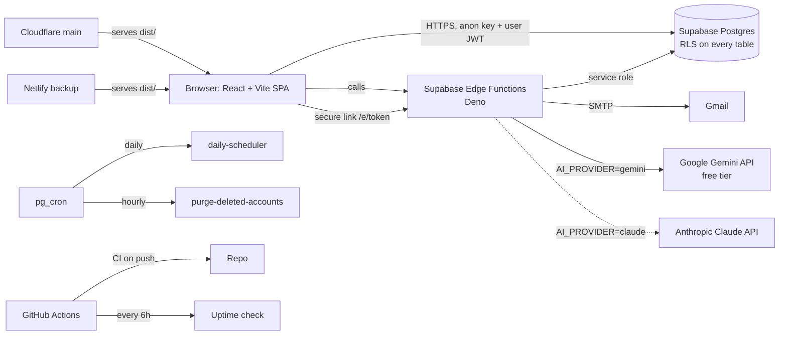

# Architecture notes

## Layers

| Layer | Technology | Notes |
| --- | --- | --- |
| Front end | React 18, TypeScript, Vite, Tailwind | Single-page app; Formidea theme; served by **Cloudflare** (main, `wrangler.jsonc`) and Netlify (backup, `netlify.toml`), both with the strict security headers in `public/_headers`. |
| Data | Supabase Postgres | Row-level security everywhere; privileged logic in SQL functions (`private` schema) and edge functions. |
| Auth | Supabase Auth | Email + password; activation by 6-digit code; secure links for people without accounts. |
| Server | Supabase Edge Functions (Deno) | ~28 functions: user management, links, emails, scheduler, AI, deletion purge. |
| Email | Gmail SMTP | Templates in `send-email/templates.ts`; secure link inserted for people without an account. |
| AI | Gemini (default) / Claude | `_shared/ai.ts` chooses the provider; `ai-insights` holds every AI feature. |
| Jobs | pg_cron + pg_net | Daily scheduler (open/close cycles, reminders) and hourly deletion purge. |
| CI / monitoring | GitHub Actions | `ci.yml` (lint, types, tests, build, Deno check), `uptime.yml`; in-app Monitoring tab (`app_events`). |

## Key data

`profiles` (role, person_type, manager_id, exclusions, deletion fields) · `talents` · `cycles` (include switches) ·
`assignments` (kind, origin, status) · `responses` · `peer_relationships` · `external_raters` · `external_evaluators` ·
`evaluation_links` · `report_shares` · `ai_person_summaries` · `ai_cycle_insights` · `audit_log` (append-only) ·
`app_events` (anonymous analytics).

## Decisions

1. **Supabase instead of a custom backend**: auth, database, RLS and functions in one place; free tier.
2. **Evaluations generated in SQL** (`generate_cycle_evaluations`): one source of truth, auditable, idempotent refresh.
3. **Signed tokens for secure links** (HMAC of id and version): nothing secret is stored; resending bumps the version.
4. **One AI function with a provider switch**: the browser never sees a key; the provider can change without UI changes.
5. **First-party analytics**: no third-party tracker, no personal data; tokens and emails are stripped in the browser.
